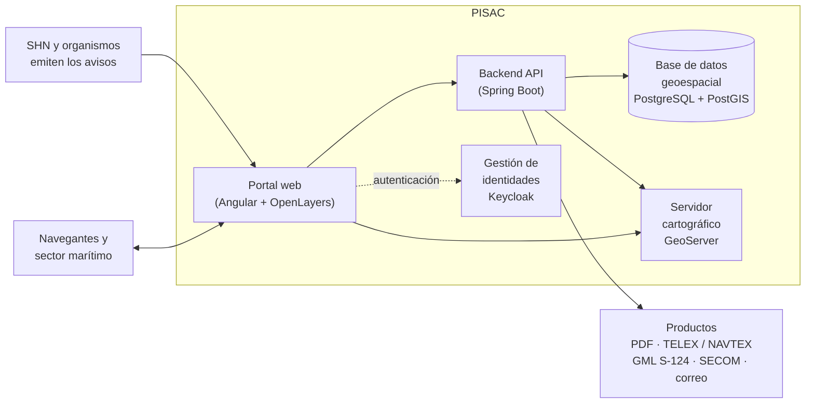

# PISAC — Plataforma de Información de Seguridad Acuática

**Servicio de Hidrografía, Oceanografía, Meteorología y Cartografiado Náutico (SHN Venezuela)**
*Oficina Coordinadora de Hidrografía y Navegación (OCHINA Venezuela)*

---

## 1. Descripción general

**PISAC** es el sistema institucional del **SHN** de la República Bolivariana de Venezuela para la producción, publicación y difusión de **advertencias náuticas** y **avisos a los navegantes** en los espacios acuáticos bajo jurisdicción nacional.

La plataforma forma parte de la transición del SHN al marco **S-100** de la **Organización Hidrográfica Internacional (OHI / IHO)**. Implementa la especificación de producto **IHO S-124 (*Navigational Warnings*)**.

---

## 2. Capacidades principales

- **Estándar IHO S-124:** series nacionales y costeras, categorías de peligro y tipos de advertencia conforme al catálogo S-124, con la terminología náutica del SHN en español.
- **Visor cartográfico náutico:** consulta de advertencias, avisos y regulaciones sobre la cartografía náutica oficial del SHN, mediante servicios geoespaciales estándar (WMTS / WMS) y un mapa base propio.
- **Ciclo de vida de los avisos:** creación asistida con su geometría, identificación de las zonas y cartas náuticas afectadas, control de vigencia y cancelación.
- **Difusión multicanal y bilingüe (ES / EN):** boletines en PDF, mensajes TELEX / NAVTEX normalizados, intercambio entre sistemas en GML S-124 mediante el servicio **SECOM** (IEC 63173-2) y notificaciones por correo electrónico.
- **Participación del usuario marítimo:** suscripciones por zona y envío de reportes al SHN.
- **Gestión institucional:** administración de organismos, zonas de responsabilidad, usuarios y cartografía náutica.

---

## 3. Repositorios

| Componente | Repositorio | Descripción |
| :--- | :--- | :--- |
| **Repositorio principal** | [`shnve/pisac`](https://github.com/shnve/pisac) | Integra el proyecto y referencia los submódulos. |
| **Backend (API)** | [`shnve/ping-api`](https://github.com/shnve/ping-api) | Servicios REST, modelo de datos S-124, procesamiento geoespacial y generación de productos (Java / Spring Boot). |
| **Portal web** | [`shnve/ping-web`](https://github.com/shnve/ping-web) | Portal público y consola de administración con visor cartográfico (Angular / OpenLayers). |
| **Documentación interna** | `shnve/pisac-docs` *(privado)* | Uso exclusivo del personal autorizado del SHN. |

```bash
git clone --recurse-submodules https://github.com/shnve/pisac.git
```

---

## 4. Arquitectura general



---

## 5. Reconocimiento de código abierto y licencia

**PISAC** se basa en los componentes de código abierto del proyecto **PING**, desarrollado originalmente por el **SHOM** (*Service Hydrographique et Océanographique de la Marine*, Francia) bajo la **Licencia Pública de la Unión Europea (EUPL v1.2)** ([texto oficial](https://interoperable-europe.ec.europa.eu/collection/eupl/eupl-text-eupl-12)).

`ping-api` y `ping-web` son *forks* de [`shom-fr/ping-api`](https://github.com/shom-fr/ping-api) y [`shom-fr/ping-web`](https://github.com/shom-fr/ping-web). Incorporan las adaptaciones hidrográficas, cartográficas, lingüísticas y operativas del **SHN Venezuela**, conservan los avisos de autoría originales (© Shom, 2020–2025) y se distribuyen conforme a la licencia **EUPL v1.2**.

---

## 6. Contacto institucional

- **Institución:** Servicio de Hidrografía, Oceanografía, Meteorología y Cartografiado Náutico (SHN Venezuela), Playa Grande, La Guaira, Venezuela.
- **Página web:** [www.shn.gob.ve](https://www.shn.gob.ve/)
- **Correo técnico:** `shnti@shn.gob.ve`
- **GitHub:** [github.com/shnve](https://github.com/shnve)
